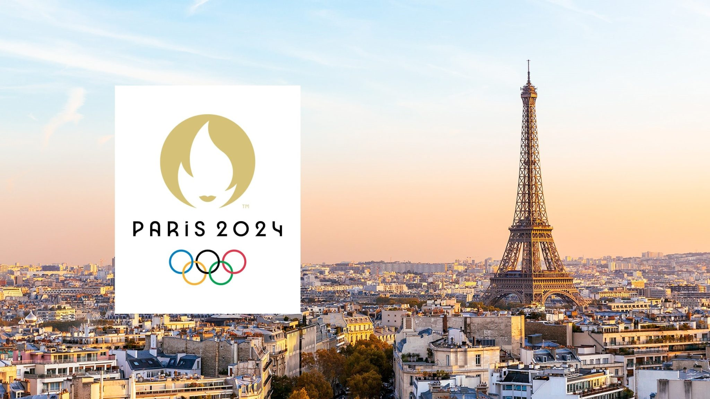
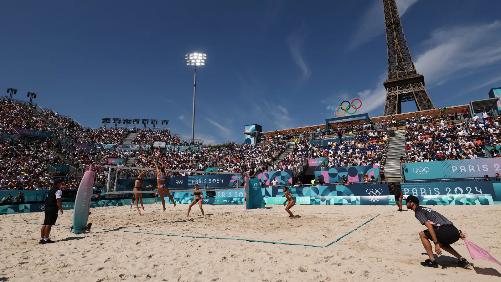
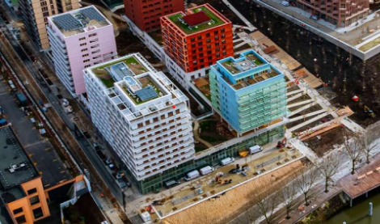
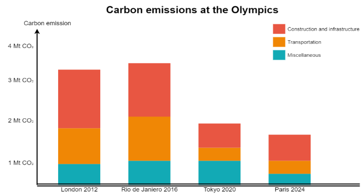

# Paris 2024 – Analyzing the Sustainability Efforts

**Paris, France**. After 124 years, Paris hosted the Olympic Games again. At the 1900 games, female athletes were allowed to participate for the first time. This time Paris 2024 aimed to become the most sustainable Olympic Games in modern history.

## Venues

**95% of all venues** used at the Paris 2024 Olympic Games were either pre-existing or temporarily constructed. By utilizing existing materials and equipment at these venues, such as benches, high tables, and microwaves, the event achieved a 25% reduction of environmental impact.

## Construction

**100% of the buildings** below 28 meters in height used wood as a structural material, including beams, posts, and floors, with a total consumption of 16,000 m³ of wood. The concrete used was low-carbon concrete (150 kg CO₂/m³) and ultra-low-carbon concrete (100 kg CO₂/m³), compared to the traditional 250 kg CO₂/m³ concrete.

## Transportation

**Paris built 415 km of cycling lanes**, along with 20,000 temporary parking spaces to form a cycling network connecting all venues in Paris. State and local authorities funded the project. All venues were accessible by public transport, and a new app was developed to help visitors navigate transport routes to the game venues.

## Outcome

Paris 2024 aimed to reduce the environmental impact of the Olympic Games through more sustainable venues, construction methods, and transportation.

### Key figures

  

    
Million tonnes CO₂e

    
1.59

    
This is the reported carbon footprint of the Games.

  

  

    
Public transportation

    
87%

    
This is the reported amount of spectators that used the public transport to reach the venues.

  

  

    
Cycling infrastructure

    
5%

    
This is the reported amount of spectators that used the newly constructed bicycle lanes.

  

### Carbon footprint comparison

Paris 2024 recorded the lowest reported carbon footprint of any modern Summer Olympic Games.                                              
